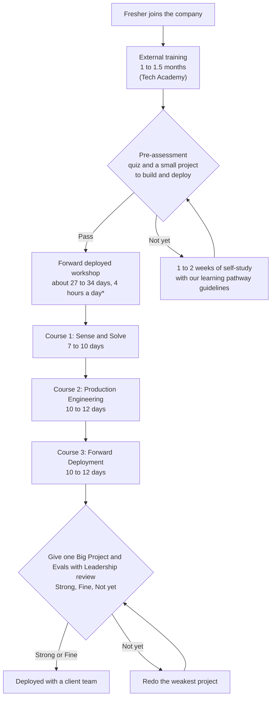
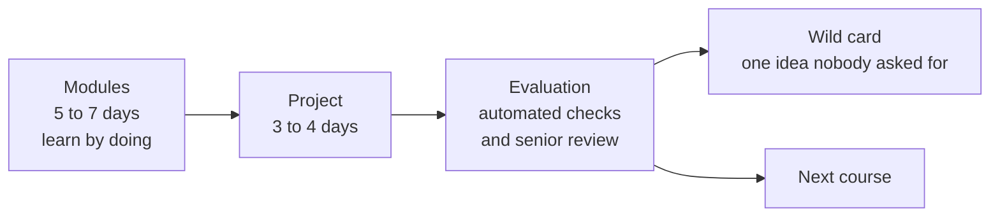

# Workshop flow

Numbers marked with an asterisk are proposals to confirm with Aditi and Rajat.

## 1. From joining to deployment

## 2. One course

## 3. Courses and modules

Time is at 4 hours a day.

### Course 1: Sense and Solve (7 to 10 days)

**1.1 Sensing and initiative** (1 to 2 days)
- Find problems nobody asked about, from data, transcripts, and outside sources
- Size and rank them by saving and effort

**1.2 Data storytelling** (1 to 2 days)
- Turn data into a clear finding, a dashboard, and an action brief
- Estimate savings and state the assumptions

**1.3 Agents and tool use** (1 to 2 days)
- Build an agent with tools, approval, and guardrails
- Know when a plain workflow is better

**1.4 Evals, benchmarks and load tests** (1 day)
- Build a test set, score the agent, compare two models
- Find where it slows down under load

**Project 1** (3 days)
- Ten use cases, three solved with agents, benchmarked, each with an action brief

### Course 2: Production Engineering (10 to 12 days)

**2.1 Shipping code** (2 days)
- Containerise, deploy from a pipeline, keep secrets out of code

**2.2 Security review** (2 to 3 days)
- Find auth, crypto, and code bugs, including LLM-specific ones
- Write up each finding with impact and fix

**2.3 Observability and operations** (2 to 3 days)
- Trace, alert, and cap spend
- An agent that reviews its own logs and opens issues; safe updates and rollback

**Project 2** (4 days)
- Put a Project 1 solution into production with a security review, load test, and runbook

### Course 3: Forward Deployment (10 to 12 days)

**3.1 Discovery and scoping** (2 days)
- Interview a customer, map the workflow, scope with a success metric and cost estimate

**3.2 Integration problems** (2 days)
- Connect real systems from a goal alone: legacy exports, sign-in, enterprise tools

**3.3 Deploying in the customer environment** (1 to 2 days)
- Deploy inside restricted networks and meet compliance checks

**3.4 Own, evolve and scale** (2 days)
- Hand off with a runbook and training
- Find unspoken user needs, scale to other teams, feed back into sensing

**Project 3** (3 to 4 days)
- Run an engagement end to end, then study usage and propose the next app
